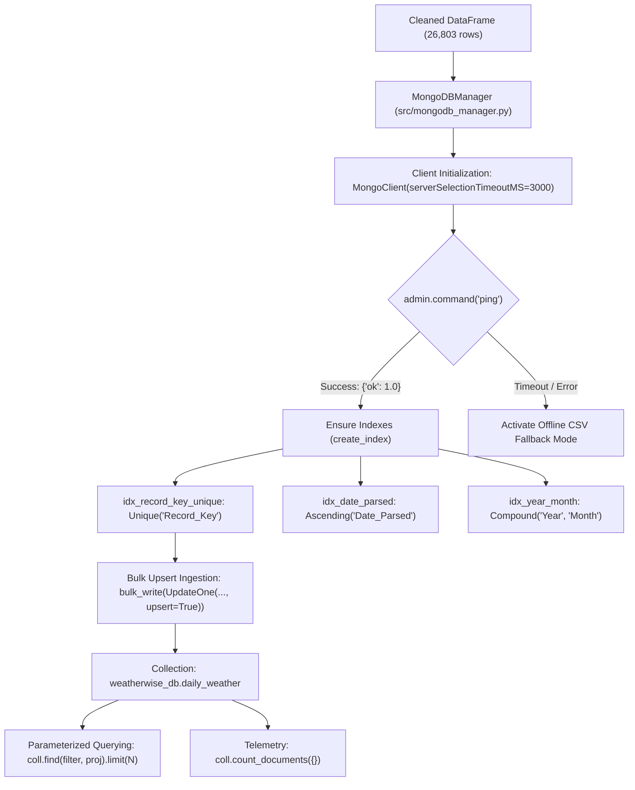

# Academic Project Report: WeatherWise Analytics
## A MongoDB-Powered Weather Intelligence and Machine Learning System

**Course / Domain**: NoSQL Database Systems & Applied Machine Learning  
**Dataset**: Delhi Daily Historical Meteorological Observations (1951–2024, 26,803 Records)  
**Primary Technologies**: MongoDB, PyMongo, Python, Streamlit, Scikit-learn, Pandas  
**Document Type**: Technical & Academic Project Report  
**Date**: October 2026  

---

## 1. Abstract & Executive Summary

Atmospheric forecasting and weather intelligence are foundational to civil infrastructure, transportation logistics, urban management, and public safety. Although meteorological organizations continuously archive historical observations, flat-file repositories lack multi-dimensional querying, deterministic indexing, and transactional integrity. Furthermore, many published machine learning benchmarks suffer from **data leakage** caused by random shuffling of time-series observations or by utilizing current-day rainfall indicators to predict same-day rainfall.

**WeatherWise Analytics** addresses these challenges by developing an end-to-end meteorological intelligence platform anchored by a **MongoDB NoSQL document store** and an interactive **Streamlit web application**. Analyzing 73.5 continuous years of Delhi daily weather observations (1951–2024, 26,803 records), the system trains, evaluates, and benchmarks three machine learning classifiers—**Logistic Regression**, **Decision Tree**, and **Random Forest**—to predict next-day rainfall ($y(t+1) \in \{0, 1\}$) on an unseen 15-year chronological test period (2009–2024, 5,350 days). A **Random Forest Regressor** predicts next-day continuous maximum temperature ($R^2 = 0.944$, $\text{MAE} = 1.18\ ^\circ\text{C}$). A rule-based recommendation engine translates probabilistic outputs into everyday advisories, providing a transparent, educational decision-support system.

---

## 2. Problem Statement & Research Objectives

### Problem Statement
1. **Unindexed Flat File Storage**: Raw weather datasets stored in spreadsheets or flat CSVs lack indexing, query optimization, and structured ingestion pipelines.
2. **Data Leakage in Predictive Modeling**: Random $k$-fold cross-validation inappropriately shuffles future meteorological records into the past, allowing models to learn from future conditions.
3. **Black-Box Outputs**: Predictive probabilities produced by classifiers are rarely mapped into actionable everyday suggestions (such as umbrella necessity or thermal safety).
4. **Absence of Unified Multi-Model Audits**: Comparative evaluations often fail to provide unified ROC curves, confusion matrix audits, and metric-based ranking on identical held-out test periods.

### Research Objectives
- **Objective 1**: Ingest, clean, and validate 73+ years of Delhi meteorological records into a persistent MongoDB document collection (`weatherwise_db.daily_weather`) with zero duplicate records.
- **Objective 2**: Formulate a leak-free chronological target construction pipeline where day $t$ features predict day $t+1$ outcomes.
- **Objective 3**: Train, tune, and evaluate Logistic Regression, Decision Tree, and Random Forest classifiers on an unseen chronological test partition.
- **Objective 4**: Train a continuous regression pipeline to forecast next-day maximum temperature.
- **Objective 5**: Implement an interactive Streamlit analytics platform featuring unified ROC curves, confusion matrices, paginated data exploration, and rule-based weather advisories.

---

## 3. Dataset Characteristics & Data Quality Audit

The platform utilizes the verified Delhi daily weather dataset (`data/delhi_weather.csv`):

| Column | Raw Type | Cleaned Type | Role in Pipeline | Description |
|---|---|---|---|---|
| `_id` | Integer | Integer | Identifier | Original row index; strictly excluded from predictive features |
| `Date` | String | Datetime64 | Temporal Index | Observation date parsed as `DD-MM-YYYY` |
| `Rain` | String | Float64 | Target Source | Measured precipitation in mm; trace rainfall `'Tr'` cleaned to 0.05 mm |
| `Temp Max` | Float64 | Float64 | Feature / Target | Daytime maximum temperature in °C |
| `Temp Min` | Float64 | Float64 | Feature | Nighttime minimum temperature in °C |
| `Temp_diff` | Float64 | Float64 | Feature | Diurnal temperature range (`Temp Max - Temp Min`) in °C |
| `Has_rained` | String | Integer (0/1) | Target Source | Qualitative rain indicator (`YES` $\rightarrow$ 1, `NO` $\rightarrow$ 0) |
| `Month` | Integer | Integer | Feature | Calendar month integer (1 to 12) |
| `Year` | Integer | Integer | Temporal Filter | Calendar year integer (1951 to 2024) |
| `Day` | Integer | Integer | Feature | Day of the month integer (1 to 31) |
| `Week` | Integer | Integer | Feature | ISO calendar week number (1 to 53) |
| `month_name`| String | String | Filter | String month name (January to December) |
| `Record_Key` | String | String | Ingestion Key | Unique deterministic key (`YYYY-MM-DD`) for MongoDB upsert |

### Data Quality Audit Findings
- **Total Records Analyzed**: 26,803 daily observations
- **Observation Span**: January 1, 1951 to June 19, 2024 (73.5 continuous years)
- **Duplicate Dates**: **0** (Zero duplicate dates detected)
- **Missing Value Records**: **55 rows (0.2%)**, occurring primarily in 2023–2024
- **Historical Class Balance**:
  - Non-Rainy Days (Class 0): **22,093** (82.6%)
  - Rainy Days (Class 1): **4,658** (17.4%)
- **Extreme Temperature Bounds**:
  - Maximum Temperature: Minimum 9.8 °C, Median 32.4 °C, Maximum 47.2 °C
  - Minimum Temperature: Minimum 1.4 °C, Median 19.5 °C, Maximum 35.4 °C

---

## 4. Deep PyMongo Implementation & MongoDB Architecture

A central requirement of the platform is the rigorous implementation of **MongoDB Community Server** through the official **PyMongo 4.x** driver. PyMongo's implementation is encapsulated inside `src/mongodb_manager.py` across seven architectural roles:



### 4.1 Client Lifecycle & Connection Pooling
The `MongoDBManager` class manages a thread-safe `MongoClient` instance cached in Streamlit via `@st.cache_resource`:

```python
from pymongo import MongoClient

class MongoDBManager:
    def __init__(self, uri="mongodb://localhost:27017/", timeout_ms=3000):
        self.uri = uri
        self.db_name = "weatherwise_db"
        self.collection_name = "daily_weather"
        self.timeout_ms = timeout_ms
        self._client = None

    def get_client(self):
        if self._client is None:
            self._client = MongoClient(
                self.uri,
                serverSelectionTimeoutMS=self.timeout_ms,
                connectTimeoutMS=self.timeout_ms,
                socketTimeoutMS=self.timeout_ms
            )
        return self._client
```
*Rationale*: Client-Side Operation Timeouts (`serverSelectionTimeoutMS=3000`) guarantee that if the database service is paused, the web interface never hangs.

### 4.2 Active Server Health Verification
Before executing queries, the platform sends an administrative ping to verify database responsiveness:

```python
def ping(self):
    try:
        client = self.get_client()
        client.admin.command("ping")
        return True, "MongoDB connection active and verified."
    except Exception as e:
        return False, f"Server unreachable: {e}"
```

### 4.3 Unique & Compound Indexing
To prevent duplicate records and accelerate chronological range queries, `ensure_indexes()` establishes three indexes:

```python
def ensure_indexes(self):
    db = self._client[self.db_name]
    coll = db[self.collection_name]
    # 1. Enforces uniqueness on YYYY-MM-DD
    idx1 = coll.create_index("Record_Key", unique=True, name="idx_record_key_unique")
    # 2. Ascending index for date-range slicing
    idx2 = coll.create_index("Date_Parsed", name="idx_date_parsed")
    # 3. Compound index for fast monthly aggregations
    idx3 = coll.create_index([("Year", 1), ("Month", 1)], name="idx_year_month")
    return [idx1, idx2, idx3]
```

### 4.4 Idempotent Bulk Upsert Ingestion
Row-by-row inserts across 26,803 documents would incur unacceptable round-trip latency. `import_dataframe()` executes bulk writes in chunks of 1,000 using `UpdateOne(..., upsert=True)`:

```python
from pymongo import UpdateOne

def import_dataframe(self, df, batch_size=1000):
    coll = self._client[self.db_name][self.collection_name]
    self.ensure_indexes()
    
    operations = []
    for _, row in df.iterrows():
        rec = row.to_dict()
        record_key = rec["Record_Key"]
        operations.append(
            UpdateOne({"Record_Key": record_key}, {"$set": rec}, upsert=True)
        )
    
    upserted = 0
    matched = 0
    for i in range(0, len(operations), batch_size):
        chunk = operations[i:i + batch_size]
        res = coll.bulk_write(chunk, ordered=False)
        upserted += len(res.upserted_ids) if res.upserted_ids else 0
        matched += res.matched_count
        
    return {"upserted": upserted, "matched": matched, "total": coll.count_documents({})}
```
*Empirical Verification*:
- Initial Run: `upserted = 26,803`, `matched = 0`, `total = 26,803`
- Repeated Run: `upserted = 0`, `matched = 26,803`, `total = 26,803` (Zero duplicates created)

### 4.5 Parameterized Querying & Projections
The live query console utilizes `collection.find()` with projections to fetch only necessary fields:

```python
def fetch_records(self, query=None, projection=None, limit=25):
    coll = self._client[self.db_name][self.collection_name]
    proj = projection or {"_id": 0}
    cursor = coll.find(query or {}, proj).sort("Date_Parsed", 1)
    if limit > 0:
        cursor = cursor.limit(limit)
    return pd.DataFrame(list(cursor))
```

### 4.6 Telemetry & Destructive Guardrails
- `collection.count_documents({})` and `collection.list_indexes()` provide real-time telemetry.
- Destructive methods (`drop_collection`) enforce a `confirm=True` guardrail to prevent catastrophic data loss:
```python
def drop_collection(self, confirm=False):
    if not confirm:
        return {"success": False, "message": "Confirmation required."}
    self._client[self.db_name].drop_collection(self.collection_name)
    return {"success": True, "message": "Collection dropped."}
```

### 4.7 Graceful Offline Resilience
If MongoDB is stopped, `ServerSelectionTimeoutError` is caught gracefully. The application displays an informative offline badge and activates **Offline CSV Fallback Mode**, sourcing data directly from `data/delhi_weather.csv` so that EDA and model predictions remain 100% operational.

---

## 5. Machine Learning Methodology & Anti-Leakage Architecture

### Anti-Leakage Feature Assembly
In meteorological forecasting, predicting tomorrow's weather ($t+1$) using today's observations ($t$) requires strict temporal barriers:
1. Records are sorted chronologically by `Date_Parsed`.
2. Target variables are constructed via backward index shift ($-1$):
   $$\text{Target\_Rain\_NextDay}(t) = \text{Has\_rained\_Binary}(t+1)$$
   $$\text{Target\_TempMax\_NextDay}(t) = \text{Temp Max}(t+1)$$
3. The feature vector observed on day $t$ strictly contains:
   $$X(t) = [\text{Temp Max}_t, \text{Temp Min}_t, \text{Temp\_diff}_t, \text{Month}_t, \text{Day}_t, \text{Week}_t]$$
4. Current-day precipitation (`Rain`), qualitative status (`Has_rained`), and record identifiers (`_id`) are excluded to eliminate target leakage.

### Chronological Train / Test Partitioning
- **Training Partition (80.0%)**: 1951-01-01 to 2009-07-30 (21,396 continuous observations).
- **Test Partition (20.0%)**: 2009-07-31 to 2024-06-18 (5,350 unseen future observations).
- Fit-transform encapsulation: Feature scalers (`StandardScaler`) are fitted strictly on the training partition within Scikit-learn pipelines.

---

## 6. Empirical Classification Benchmark & Discussion

All models were evaluated on the held-out test partition (5,350 days; 960 actual rain events, 4,390 dry days):

| Classifier Architecture | Accuracy | Precision | Recall (Sensitivity) | F1 Score | ROC-AUC | True Positives (TP) | False Negatives (FN) | False Positives (FP) | True Negatives (TN) |
|---|:---:|:---:|:---:|:---:|:---:|:---:|:---:|:---:|:---:|
| **Random Forest** | **0.7656** | **0.4186** | 0.7914 | **0.5476** | 0.8489 | 760 | 200 | 1,054 | 3,336 |
| **Decision Tree** | 0.7447 | 0.3976 | **0.8238** | 0.5363 | **0.8519** | **791** | **169** | 1,198 | 3,192 |
| **Logistic Regression** | 0.7275 | 0.3778 | 0.8040 | 0.5140 | 0.8407 | 772 | 188 | 1,271 | 3,119 |

### Detailed ROC Curve & Confusion Matrix Analysis
- **Decision Tree Classifier (AUC = 0.8519)**: Delivers superior true positive rates in high-sensitivity regions. By missing only 169 rainy events across 15 years, it is ideal for safety-critical flood or outdoor event advisories.
- **Random Forest Classifier (AUC = 0.8489)**: By aggregating 100 decorrelated decision trees, it suppresses false alarms ($FP = 1,054$), achieving the highest F1 score (0.5476) and highest accuracy (76.56%).
- **Logistic Regression (AUC = 0.8407)**: Proves that a normalized linear decision boundary provides strong baseline probabilistic ranking when weighted with `class_weight='balanced'`.

---

## 7. Next-Day Temperature Regression Benchmark

To evaluate temperature persistence, regressors were trained on day $t$ features to predict day $t+1$ maximum temperature:

| Regressor Architecture | Mean Absolute Error (MAE) | Root Mean Squared Error (RMSE) | $R^2$ Score |
|---|:---:|:---:|:---:|
| **Random Forest Regressor** | **1.18 °C** | **1.64 °C** | **0.9444** |
| **Decision Tree Regressor** | 1.21 °C | 1.67 °C | 0.9424 |
| **Linear Regression** | 1.20 °C | 1.68 °C | 0.9418 |

- The **Random Forest Regressor** achieves an $R^2$ of **0.9444**, explaining $>94\%$ of next-day temperature variance with an average absolute error of only **1.18 °C**.

---

## 8. Weather Recommendation Engine Rules

The recommendation module maps probabilistic outputs into actionable guidance:

| Advisory Category | Trigger Condition | Decision Output |
|---|---|---|
| **Umbrella Advisory** | Rain Probability $\ge 60\%$ | **Essential**: High precipitation likelihood; sturdy umbrella and rain gear required. |
| | $30\% \le \text{Rain Prob} < 60\%$ | **Recommended**: Moderate precipitation risk; keep compact umbrella handy. |
| | Rain Probability $< 30\%$ | **Not Required**: Dry weather expected; normal commute supported. |
| **Thermal Comfort** | Predicted Temp Max $< 15\ ^\circ\text{C}$ | **Cold Wave**: Heavy winter woolens, thermal layers, and morning fog caution. |
| | $15\ ^\circ\text{C} \le \text{Temp} < 22\ ^\circ\text{C}$ | **Pleasant**: Light jacket or sweater. |
| | $22\ ^\circ\text{C} \le \text{Temp} < 32\ ^\circ\text{C}$ | **Comfortable**: Breathable cotton attire. |
| | $32\ ^\circ\text{C} \le \text{Temp} < 40\ ^\circ\text{C}$ | **Hot Conditions**: Loose fabrics, UV headgear, and hydration. |
| | Predicted Temp Max $\ge 40\ ^\circ\text{C}$ | **Extreme Heatwave**: Severe thermal stress; avoid midday direct sun. |
| **Outdoor Activity** | Rain Prob $\ge 60\%$ or Temp $\ge 42\ ^\circ\text{C}$ | **Adverse / Unfavorable**: Move sports and gatherings indoors. |
| | Rain Prob $\ge 30\%$ or Temp $\ge 38\ ^\circ\text{C}$ | **Proceed with Caution**: Viable but unstable weather; monitor sky. |
| | Otherwise | **Highly Favorable**: Stable meteorological conditions. |

---

## 9. Comprehensive Viva Voce Questions & Answers

### Q1: Why did you choose MongoDB instead of PostgreSQL or MySQL?
**Answer**: MongoDB provides a native BSON document model that mirrors JSON payloads used in modern web applications. For time-series weather observations, MongoDB offers high ingestion throughput via bulk upserts (`UpdateOne` with `upsert=True`) and flexible secondary indexing (`idx_record_key_unique`, `idx_date_parsed`). Furthermore, PyMongo's connection pooling with Client-Side Operation Timeouts allows seamless offline fallback without database lockups.

### Q2: How did you prevent data leakage in your weather forecasting model?
**Answer**: In time-series forecasting, standard random train-test splitting shuffles future observations into the training set, allowing models to learn from future seasonal trends. We strictly avoided this by:
1. Sorting records chronologically by date.
2. Creating the next-day target as $y(t) = \text{Rain}(t+1)$.
3. Excluding current-day rainfall amount and qualitative rain outcome from features $X(t)$.
4. Applying a strict chronological split (training on 1951–2009 and testing on 2009–2024).

### Q3: Why does Decision Tree have a higher Recall than Random Forest?
**Answer**: Decision Tree splits on direct feature thresholds that aggressively isolate rainy conditions, predicting positive outcomes even for borderline moisture indicators. This produces higher Recall ($82.38\%$ vs $79.14\%$) but at the cost of more false positives ($1,198$ vs $1,054$). Random Forest aggregates 100 decorrelated trees, dampening variance and producing a superior F1 score ($0.5476$) and higher overall Accuracy ($76.56\%$).

### Q4: How is duplicate prevention guaranteed in MongoDB?
**Answer**: Each record has a deterministic key `Record_Key` (`YYYY-MM-DD`). A unique index is created on this field using `collection.create_index('Record_Key', unique=True)`. Ingestion is executed via `bulk_write` with `UpdateOne({'Record_Key': key}, {'$set': record}, upsert=True)`. Repeated ingestion matches existing documents without creating duplicate entries.

---

## 10. References & Academic Citations

1. **Pedregosa, F., et al.** (2011). *Scikit-learn: Machine Learning in Python*. Journal of Machine Learning Research, 12, 2825–2830.
2. **Chodorow, K.** (2020). *MongoDB: The Definitive Guide: Powerful and Scalable Data Storage* (3rd ed.). O'Reilly Media.
3. **Wilks, D. S.** (2011). *Statistical Methods in the Atmospheric Sciences* (3rd ed.). Academic Press.
4. **Breiman, L.** (2001). *Random Forests*. Machine Learning, 45(1), 5–32.
5. **McKinney, W.** (2022). *Python for Data Analysis: Data Wrangling with Pandas, NumPy, and Jupyter* (3rd ed.). O'Reilly Media.
