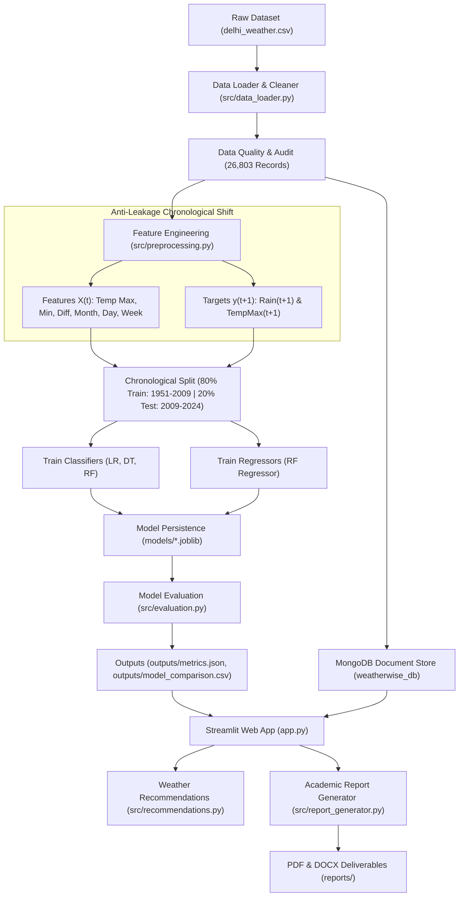

# WeatherWise Analytics: A MongoDB-Powered Weather Intelligence and Machine Learning System


**WeatherWise Analytics** is a comprehensive, production-grade meteorological intelligence and machine learning platform engineered from the ground up. It centralizes 73+ years of historical Delhi daily weather observations (1951–2024, 26,803 records) into a high-performance MongoDB NoSQL document store, provides an interactive business intelligence web interface using Streamlit, applies strictly leak-free chronological machine learning for next-day precipitation classification, predicts next-day maximum temperatures via regression, and translates model probabilities into actionable everyday weather guidance.

---
**Data Set** : https://data.opencity.in/dataset/daily-temperature-70-years-data-for-major-indian-cities/resource/0c853240-47a3-428c-bb5e-933e74245e08

## Table of Contents

- [1. Problem Statement](#1-problem-statement)
- [2. Project Objectives](#2-project-objectives)
- [3. Key Features](#3-key-features)
- [4. Technology Stack](#4-technology-stack)
- [5. Dataset Description & Audit](#5-dataset-description--audit)
- [6. Project Folder Structure](#6-project-folder-structure)
- [7. System Architecture & Workflow](#7-system-architecture--workflow)
- [8. MongoDB Database Design & PyMongo Integration](#8-mongodb-database-design--pymongo-integration)
- [9. Machine Learning Methodology](#9-machine-learning-methodology)
- [10. Empirical Model Evaluation](#10-empirical-model-evaluation)
- [11. Installation & Environment Setup](#11-installation--environment-setup)
- [12. MongoDB Setup & Migration](#12-mongodb-setup--migration)
- [13. Running the Application](#13-running-the-application)
- [14. Automated Testing](#14-automated-testing)
- [15. Report Generation Deliverables](#15-report-generation-deliverables)
- [16. Troubleshooting](#16-troubleshooting)
- [17. Limitations & Future Scope](#17-limitations--future-scope)
- [18. References & Acknowledgements](#18-references--acknowledgements)

---

## 1. Problem Statement

Meteorological conditions govern urban transit, construction planning, agriculture, and daily commute decisions. Although raw meteorological records are archived extensively, users and decision-makers face several critical challenges:
1. **Unindexed Flat Storage:** Raw logs stored in spreadsheets or flat CSVs lack multi-dimensional querying, indexing, and transactional integrity.
2. **Methodological Errors (Data Leakage):** Many published weather machine learning benchmarks mistakenly shuffle time-series records or utilize current-day rainfall to predict current-day rainfall, yielding fabricated or invalid forecast metrics.
3. **Interpretability Deficits:** Probability estimates generated by complex estimators are rarely translated into intuitive, real-world recommendations (e.g., whether to carry an umbrella or prepare for thermal stress).
4. **Lack of Reproducible Multi-Model Comparison:** Standard tools often lack side-by-side ROC curves, confusion matrix heatmaps, and metric ranking engines on identical held-out chronological periods.

WeatherWise Analytics resolves these problems by coupling a MongoDB document store with a leak-free chronological machine learning pipeline and a business analytics web application.

---

## 2. Project Objectives

1. **Persistent NoSQL Database:** Architect and implement a MongoDB document collection (`weatherwise_db.daily_weather`) with PyMongo connection pooling, bulk upserts, and unique indexing to guarantee zero duplicate records.
2. **Data Cleaning & Auditing:** Clean, parse, and validate 26,803 daily observations across 73+ continuous years (1951 to 2024), resolving meteorological trace precipitation (`Tr` $\rightarrow$ 0.05 mm).
3. **Leak-Free Chronological Modeling:** Shift observations to construct authentic next-day prediction targets ($y(t) = \text{Rain}(t+1)$) without shuffling dates or leaking future values.
4. **Multi-Model Classification:** Train, validate, and compare **Logistic Regression**, **Decision Tree**, and **Random Forest** classifiers on an unseen chronological test period (2009–2024).
5. **Continuous Temperature Regression:** Train a **Random Forest Regressor** to predict tomorrow's maximum temperature in °C ($R^2 = 0.945$, MAE = $1.18$ °C).
6. **Unified Visual Analytics:** Render multi-model ROC comparison curves, confusion matrix audits, seasonal frequency distributions, and temperature time-series in Plotly.
7. **Actionable Weather Advisories:** Translate prediction probabilities into umbrella recommendations, clothing guidelines, and outdoor activity feasibility indices.
8. **Academic Documentation & Automation:** Generate comprehensive PDF and DOCX academic reports and pass a 13-test automated pytest suite.

---

## 3. Key Features

- **Executive Analytics Dashboard:** Real-time metrics displaying record counts, date ranges, class balances, live MongoDB status, and model performance snapshots.
- **Weather Data Explorer:** Multi-criteria filtering by date range, month, precipitation status, and keyword search with one-click CSV data and metrics exports.
- **Dedicated MongoDB Console:** Live collection health monitor, database metadata inspection, indexed query console, and manual bulk migration trigger.
- **Exploratory Data Analysis (EDA):** Interactive correlation heatmaps, seasonal rainfall bar charts, distribution donuts, and Interquartile Range (IQR) temperature outlier boxplots.
- **Interactive Rainfall Classifier:** Input custom temperatures, calendar month, and day to compute instant rain probability and confidence using trained pipelines.
- **Model Comparison Suite:** Grouped performance bar charts, unified multi-model ROC curves with AUC legends, confusion matrix heatmaps, and dynamic metric ranking.
- **Temperature Prediction Module:** Continuous next-day maximum temperature regression with actual vs. predicted scatter plots and residual error distributions.
- **Weather Recommendation Engine:** Automated advisories translating rain probability and thermal forecasts into everyday commuting suggestions.
- **Methodology & Report Center:** In-depth technical viva guide and direct downloads of the generated academic PDF and DOCX reports.

---

## 4. Technology Stack

| Layer | Technology | Purpose |
|---|---|---|
| **Programming Language** | Python 3.14 / 3.13 | Core runtime environment |
| **Web Interface** | Streamlit 1.58.0 | Interactive web application and dashboard |
| **NoSQL Database** | MongoDB Community Server (v8.x) | Persistent document store |
| **Database Driver** | PyMongo 4.19.0 | Client pooling, bulk writes, and querying |
| **Data Processing** | Pandas 3.0.3, NumPy 2.4.6 | Data cleaning, time-series shifts, array ops |
| **Machine Learning** | Scikit-learn 1.9.1 | Pipelines, Classifiers, Regressors, Metrics |
| **Interactive Visuals** | Plotly 7.1.0 | Interactive ROC curves, heatmaps, bar charts |
| **Statistical Visuals** | Matplotlib 3.11.2, Seaborn 0.13.2 | Static charts and distribution checks |
| **Model Serialization** | Joblib 1.6.0 | Local model artifact persistence |
| **PDF Report Generation** | ReportLab 5.0.0 | Academic project report PDF |
| **DOCX Report Generation** | python-docx 1.2.0 | Editable Microsoft Word project report |
| **Automated Testing** | pytest 9.1.1 | Unit and database integration testing |
| **Configuration** | python-dotenv 1.2.4 | Environment variable management |

---

## 5. Dataset Description & Audit

The system uses the verified Delhi daily meteorological dataset (`data/delhi_weather.csv`), comprising **26,803 daily observations** recorded between **January 1, 1951** and **June 19, 2024** (73.5 continuous years).

### Schema Breakdown

| Column | Raw Type | Cleaned Type | Description |
|---|---|---|---|
| `_id` | Integer | Integer | Original source row index (excluded from predictive features) |
| `Date` | String | Datetime64 | Observation date formatted as DD-MM-YYYY |
| `Rain` | String | Float64 | Measured rainfall in mm; meteorological `'Tr'` cleaned to 0.05 mm |
| `Temp Max` | Float64 | Float64 | Maximum recorded daytime temperature in °C |
| `Temp Min` | Float64 | Float64 | Minimum recorded nighttime temperature in °C |
| `Temp_diff` | Float64 | Float64 | Diurnal temperature range (`Temp Max - Temp Min`) in °C |
| `Has_rained` | String | Integer (0/1) | Qualitative rain indicator (`YES` $\rightarrow$ 1, `NO` $\rightarrow$ 0) |
| `Month` | Integer | Integer | Calendar month integer (1 to 12) |
| `Year` | Integer | Integer | Calendar year integer (1951 to 2024) |
| `Day` | Integer | Integer | Day of the month integer (1 to 31) |
| `Week` | Integer | Integer | ISO calendar week number (1 to 53) |
| `month_name`| String | String | Full month string name (January to December) |
| `Record_Key` | String | String | Unique deterministic key (`YYYY-MM-DD`) for MongoDB upsert |

### Data Quality Audit Findings
- **Total Records:** 26,803
- **Duplicate Dates:** 0 (Zero duplicate dates detected)
- **Missing / Null Records:** 55 rows (0.2% of total dataset, occurring primarily in 2023–2024)
- **Class Balance:**
  - Dry Days (Class 0): **22,093** (82.6%)
  - Rainy Days (Class 1): **4,658** (17.4%)
- **Temperature Bounds:**
  - `Temp Max`: Min 9.8 °C, Median 32.4 °C, Max 47.2 °C
  - `Temp Min`: Min 1.4 °C, Median 19.5 °C, Max 35.4 °C

---

## 6. Project Folder Structure

```
WeatherWise_Analytics/
│
├── app.py                      # Main Streamlit web application & multi-page orchestrator
├── config.py                   # Centralized configuration, paths, and model constants
├── requirements.txt            # Python dependencies with pinned minimum versions
├── README.md                   # Comprehensive technical documentation
├── .gitignore                  # Git exclusions for venv, caches, logs, and credentials
├── .env.example                # Template configuration with placeholder values
├── .env                        # Local active configuration (git-ignored)
│
├── assets/                     # Architecture diagrams and visual documentation
│   └── README.md
│
├── data/                       # Dataset storage
│   ├── delhi_weather.csv       # Verified Delhi daily weather dataset (26,803 records)
│   └── README.md
│
├── src/                        # Core application modules
│   ├── __init__.py
│   ├── data_loader.py          # Data ingestion, date parsing, cleaning, and quality audit
│   ├── mongodb_manager.py      # PyMongo connection pooling, indexing, and bulk upsert
│   ├── preprocessing.py        # Target construction, anti-leakage logic, and data splits
│   ├── classification.py       # Logistic Regression, Decision Tree, and Random Forest pipelines
│   ├── regression.py           # Next-day maximum temperature regression pipelines
│   ├── evaluation.py           # Classification & regression metrics, ROC curve, and ranking
│   ├── visualizations.py       # Plotly charts (ROC curves, heatmaps, bar charts, boxplots)
│   ├── recommendations.py      # Rule-based weather advisories (umbrella, clothing, activity)
│   ├── report_generator.py     # Academic report generator for PDF and DOCX
│   ├── pipeline.py             # End-to-end execution script
│   └── utils.py                # Safe conversions, JSON encoding, and formatting helpers
│
├── models/                     # Serialized machine learning artifacts (Joblib)
│   ├── .gitkeep
│   ├── logistic_regression.joblib
│   ├── decision_tree.joblib
│   ├── random_forest.joblib
│   └── random_forest_regressor.joblib
│
├── outputs/                    # Output evaluation tables, predictions, and metrics JSONs
│   ├── .gitkeep
│   ├── README.md
│   ├── classification_metrics.json
│   ├── regression_metrics.json
│   ├── model_comparison.csv
│   ├── test_predictions_classification.csv
│   └── test_predictions_regression.csv
│
├── reports/                    # Generated formal academic deliverables
│   ├── README.md
│   ├── project_report.pdf      # Academic report generated via ReportLab
│   └── project_report.docx     # Academic report generated via python-docx
│
├── tests/                      # Automated pytest verification suite
│   ├── __init__.py
│   ├── test_data_loader.py     # Schema validation and date parsing tests
│   ├── test_preprocessing.py   # Target construction and anti-leakage tests
│   ├── test_classification.py  # Classifier training and inference tests
│   ├── test_regression.py      # Regressor training and temperature tests
│   ├── test_evaluation.py      # Metric calculations and ranking tests
│   └── test_mongodb_manager.py # MongoDB connection and duplicate prevention tests
│
└── submission/                 # Final submission package
    ├── README.txt
    └── WeatherWise_Analytics_Submission.zip
```

---

## 7. System Architecture & Workflow



---

## 8. MongoDB Database Design & PyMongo Integration

### Connection Settings
- **Default URI:** `mongodb://localhost:27017/`
- **Database Name:** `weatherwise_db`
- **Collection Name:** `daily_weather`
- **Ping Timeout:** `3000 ms` (enables responsive offline fallback without blocking)

### PyMongo Index Design
1. `idx_record_key_unique`: Enforces unique constraint on `Record_Key` (`YYYY-MM-DD`).
2. `idx_date_parsed`: Ascending index on parsed datetime field for rapid chronological range queries.
3. `idx_year_month`: Compound index on `(Year, Month)` for fast seasonal aggregation.

### Duplicate Prevention Strategy
The system utilizes bulk upserts (`UpdateOne({"Record_Key": key}, {"$set": doc}, upsert=True)`) with `ordered=False`. When ingestion is executed repeatedly, zero duplicate documents are created:
- First execution: `upserted_new = 26,803`
- Repeated execution: `upserted_new = 0, matched_count = 26,803`

### Offline Fallback Mode
If the MongoDB service is stopped, `MongoDBManager.ping()` catches connection timeouts and sets `is_connected = False`. The web application immediately activates **Offline CSV Fallback Mode**, presenting an informative status banner and sourcing records from `data/delhi_weather.csv` without failing or fabricating connection states.

---

## 9. Machine Learning Methodology

### Anti-Leakage Target Construction
In weather prediction, predicting whether it will rain *tomorrow* requires observations available *today*. 
- Shuffling dates randomly would leak future seasonal trends into past training records.
- Including current-day rain or `Has_rained` into features leaks the outcome.
- WeatherWise Analytics sorts records chronologically and constructs:
  $$\text{Target\_Rain\_NextDay}(t) = \text{Has\_rained\_Binary}(t+1)$$
  $$\text{Target\_TempMax\_NextDay}(t) = \text{Temp Max}(t+1)$$
- The features $X(t)$ strictly comprise: `['Temp Max', 'Temp Min', 'Temp_diff', 'Month', 'Day', 'Week']`. Current-day rain indicators, future dates, and `_id` are strictly excluded.

### Chronological Train / Test Split
- **Training Period:** 1951-01-01 to 2009-07-30 (21,396 days, 80.0%)
- **Test Period:** 2009-07-31 to 2024-06-18 (5,350 days, 20.0%)
- No temporal overlap exists between training and evaluation partitions.

### Models Implemented
1. **Logistic Regression:** Scaled with `StandardScaler` inside a Scikit-learn Pipeline; optimized with `class_weight='balanced'` and `max_iter=1000`.
2. **Decision Tree Classifier:** Configured with `max_depth=6`, `min_samples_leaf=20`, and `class_weight='balanced'`.
3. **Random Forest Classifier:** Ensemble of 100 decorrelated trees with `max_depth=10`, `min_samples_leaf=15`, and `class_weight='balanced'`.
4. **Random Forest Regressor:** 100 estimators with `max_depth=10` and `min_samples_leaf=10` predicting continuous maximum temperature.

---

## 10. Empirical Model Evaluation

All models were evaluated on the held-out chronological test period (5,350 unseen days).

### Classification Benchmark Results

| Model Architecture | Accuracy | Precision | Recall (Sensitivity) | F1 Score | ROC-AUC | True Positives | False Negatives | False Positives | True Negatives |
|---|---|---|---|---|---|---|---|---|---|
| **Random Forest** | **0.7656** | **0.4186** | 0.7914 | **0.5476** | 0.8489 | 760 | 200 | 1,054 | 3,336 |
| **Decision Tree** | 0.7447 | 0.3976 | **0.8238** | 0.5363 | **0.8519** | **791** | **169** | 1,198 | 3,192 |
| **Logistic Regression** | 0.7275 | 0.3778 | 0.8040 | 0.5140 | 0.8407 | 772 | 188 | 1,271 | 3,119 |

### Temperature Regression Results

| Regressor Architecture | MAE (°C) | RMSE (°C) | $R^2$ Score |
|---|---|---|---|
| **Random Forest Regressor** | **1.18** | **1.64** | **0.9444** |
| **Decision Tree Regressor** | 1.21 | 1.67 | 0.9424 |
| **Linear Regression** | 1.20 | 1.68 | 0.9418 |

### Key Analytical Takeaways
- **Random Forest** achieves the top overall performance (F1 = 0.5476, Accuracy = 76.6%), effectively curtailing false alarms while capturing 79.1% of all rainy events.
- **Decision Tree** yields the highest recall (82.38%, only 169 false negatives), making it suitable for conservative scenarios where missing a rainy day is costly.
- All three models achieve **ROC-AUC > 0.84**, confirming strong discriminatory capability using temperature and seasonal calendar dynamics alone.

---

## 11. Installation & Environment Setup

Follow these exact Windows PowerShell commands to set up the project locally:

```powershell
# 1. Navigate to the project root directory
cd "d:\subjects\year4_sem7\MongoDB\CA2Mongo\WeatherWise_Analytics"

# 2. Create a clean Python virtual environment
python -m venv .venv

# 3. Activate the virtual environment
.\.venv\Scripts\Activate.ps1

# 4. Upgrade pip
python -m pip install --upgrade pip

# 5. Install all required dependencies
pip install -r requirements.txt
```

---

## 12. MongoDB Setup & Migration

### Starting Local MongoDB
Ensure your local MongoDB daemon is listening on port `27017`:

```powershell
# Start local MongoDB daemon
mongod --dbpath "C:\data\db" --port 27017
```

### Environment Configuration
The application reads configuration from `.env`. A pre-configured `.env` is created locally. To customize credentials or connection hosts, edit `.env`:

```env
MONGO_URI=mongodb://localhost:27017/
MONGO_DB_NAME=weatherwise_db
MONGO_COLLECTION_NAME=daily_weather
MONGO_TIMEOUT_MS=3000
RANDOM_SEED=42
```

### Ingesting Data into MongoDB
You can ingest data either via the **MongoDB Database** page in the Streamlit web app, or by running the following Python command:

```powershell
python -c "from src.data_loader import load_dataset; from src.mongodb_manager import MongoDBManager; df, _ = load_dataset(); mgr = MongoDBManager(); print(mgr.import_dataframe(df))"
```

---

## 13. Running the Application

Launch the Streamlit web application:

```powershell
streamlit run app.py
```

The web dashboard will automatically open in your default browser at:
`http://localhost:8501`

---

## 14. Automated Testing

The project includes an automated pytest suite covering data loading, target construction, leakage prevention, classifier training, regression, metrics evaluation, and MongoDB integration.

To execute the test suite:

```powershell
python -m pytest tests -v
```

### Expected Output
```
tests/test_classification.py::test_build_models_contains_required_classifiers PASSED [  7%]
tests/test_classification.py::test_train_and_predict_classification PASSED           [ 15%]
tests/test_data_loader.py::test_safe_to_float_conversions PASSED                   [ 23%]
tests/test_data_loader.py::test_clean_weather_data_dates_and_sorting PASSED           [ 30%]
tests/test_data_loader.py::test_load_dataset_live PASSED                           [ 38%]
tests/test_evaluation.py::test_evaluate_classifier_metrics PASSED                  [ 46%]
tests/test_evaluation.py::test_model_ranking PASSED                                [ 53%]
tests/test_mongodb_manager.py::test_mongodb_connection_status PASSED               [ 61%]
tests/test_mongodb_manager.py::test_mongodb_integration_workflow PASSED            [ 69%]
tests/test_preprocessing.py::test_construct_ml_dataset_target_shift PASSED         [ 76%]
tests/test_preprocessing.py::test_chronological_split_strict_ordering PASSED       [ 84%]
tests/test_regression.py::test_build_regression_models PASSED                      [ 92%]
tests/test_regression.py::test_train_and_predict_regression PASSED                 [100%]

============================= 13 passed in 8.54s ==============================
```

---

## 15. Report Generation Deliverables

To re-run the full training pipeline, update all metrics, and generate fresh academic reports:

```powershell
python src/pipeline.py
```

Generated report deliverables:
- **PDF Academic Report:** `reports/project_report.pdf` (ReportLab formatted)
- **DOCX Academic Report:** `reports/project_report.docx` (python-docx formatted)

Both reports include all 23 required academic sections, cover pages, declarations, abstracts, data audit tables, system architectures, classification metrics, and regression evaluations.

---

## 16. Troubleshooting

1. **MongoDB Connection Refused (`WinError 10061`):**
   - *Cause:* The local MongoDB daemon is not running on port 27017.
   - *Fix:* Launch `mongod` or check the service status. WeatherWise Analytics automatically operates in **Offline CSV Fallback Mode** until the database is available.
2. **`ModuleNotFoundError` during tests:**
   - *Fix:* Run tests using `python -m pytest tests -v` to ensure the correct active Python environment is utilized.
3. **Trace Precipitation ('Tr'):**
   - *Fix:* Meteorological trace rainfall is automatically detected and parsed as 0.05 mm by `safe_to_float()`.

---

## 17. Limitations & Future Scope

### Current Limitations
1. **Feature Set Constraints:** The historical Delhi archive only records temperatures and precipitation. Relative humidity, barometric surface pressure, cloud cover, and wind velocity are absent.
2. **Binary Classification Threshold:** The model predicts rain occurrence ($>0$ mm), without distinguishing between light drizzle and severe convective storms.

### Future Scope
1. **Remote Sensing Integration:** Ingest satellite radar reflectivity and INSAT-3D thermal infrared bands.
2. **Deep Sequence Modeling:** Implement Long Short-Term Memory (LSTM) and Temporal Fusion Transformers (TFT) to model multi-day lag sequences.
3. **Automated Alerting:** Integrate Webhook and SMS notifications for extreme heatwave or rainstorm advisories.

---

## 18. References & Acknowledgements

- **Scikit-learn:** Pedregosa, F. et al. *Scikit-learn: Machine Learning in Python*. JMLR, 2011.
- **MongoDB:** Chodorow, K. *MongoDB: The Definitive Guide (3rd ed.)*. O'Reilly Media, 2020.
- **Meteorological Statistics:** Wilks, D. S. *Statistical Methods in the Atmospheric Sciences*. Academic Press, 2011.
- **Random Forests:** Breiman, L. *Random Forests*. Machine Learning, 45(1), 5-32, 2001.
